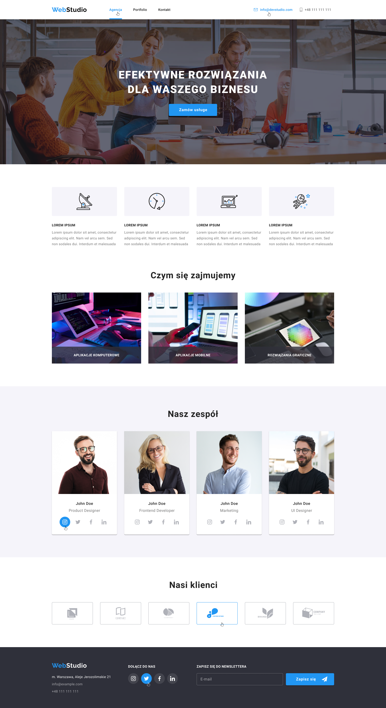
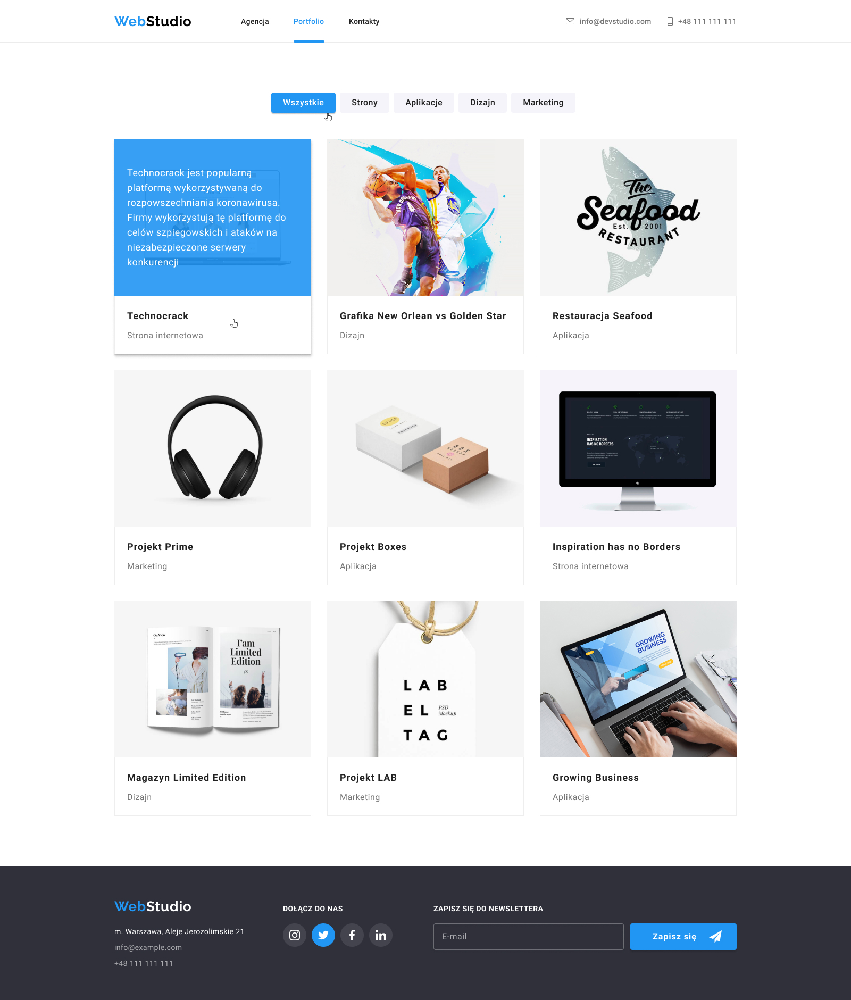

<p align="center">
  
</p>

## About

**Live site:** [damtchorzewski.github.io/WebStudio](https://damtchorzewski.github.io/WebStudio/)

**WebStudio** is a two-page, responsive site of a fictional web agency, built as a front-end exercise: a home page
that presents the offer, the team, the skills and the clients, and a portfolio page with nine sample projects. It
is plain HTML, SASS-compiled CSS and a little JavaScript, with no build step in the repository.

- **Semantic HTML5.** `index.html` (hero banner with a contact modal, "what we do", team, skills, clients, footer
  with a newsletter form and social links) and `portfolio.html`.
- **BEM and SASS.** Styles follow the BEM methodology; the sources are in `sass/` (components and utilities) and are
  compiled to minified CSS with source maps in `css/`.
- **Mobile-first.** Media queries adjust the layout at 480 px, 768 px and 1200 px.
- **Mobile menu and modal.** A burger menu (`js/mobile-menu.js`, with `body-scroll-lock` from a CDN) and a
  contact modal (`js/modal.js`).
- **Responsive images.** Background and content images come in `@1x`, `@2x` and `@3x` variants per breakpoint.
- **Portfolio.** Nine projects as cards with an image, a name and a category, and a row of category buttons.

> **Status:** a finished exercise with placeholder content: the team members are "John Doe" and the skill cards
> hold Lorem ipsum. The category buttons on the portfolio page are markup only: no script filters the cards yet.

## Tech stack

|          |                                                                                              |
| -------- | -------------------------------------------------------------------------------------------- |
| Stack    | HTML5, SASS (compiled to `css/*.min.css`), vanilla JavaScript; no framework, no bundler      |
| UI       | BEM, mobile-first, `modern-normalize` and Google Fonts from CDNs                             |
| Tests    | none                                                                                         |
| Hosting  | GitHub Pages                                                                                 |

The page content is in Polish; the README, commits and branches are in English.

## Screenshots

<p align="center">
  
</p>
<p align="center">
  
</p>

## Quick start

```bash
git clone https://github.com/DamTchorzewski/WebStudio.git
cd WebStudio
npx serve .      # or open index.html in a browser
```

Requirements: none to view the site (open `index.html`); Node.js is only needed for the optional `npx serve`. To
change the styles, edit `sass/` and compile it to `css/` with the *Live Sass Compiler* extension of VS Code (the
settings are in `.vscode/settings.json`) or the `sass` command line.

## Scripts

There is no `package.json` scripts section (the repository has only an empty `package-lock.json`). One command
rebuilds the CSS, if you have the Sass CLI:

| Command                                                                                  | What it does                                  |
| ---------------------------------------------------------------------------------------- | --------------------------------------------- |
| `sass --style=compressed sass/main.scss css/main.min.css`                                | compile the home page styles                  |
| `sass --style=compressed sass/portfolio.scss css/portfolio.min.css`                      | compile the portfolio page styles             |

## Configuration

None: no environment variables, keys or settings; the newsletter form and the contact modal are front-end only.

## Structure

```
index.html            ★ home page
portfolio.html        ★ portfolio page
sass/                 main.scss, portfolio.scss, components/ (header, menu, banner, team, skills, clients, modal...), utils/
css/                  compiled and minified styles with source maps (generated from sass/)
js/                   mobile-menu.js, modal.js
images/               site images in @1x / @2x / @3x variants
docs/                 documentation and the screenshots used above
.vscode/              Live Sass Compiler settings
```

## Branches and workflows

Shared standards from `reops/standards`: `main` ≤ `develop` ≤ a working branch `<type>/<topic>`, fast-forward
merges, Conventional Commits in English. The repository has no workflows: GitHub Pages serves the files as they are.

**Departures from the standards (and why):**

- **No build, hooks, tests or CI:** a static course exercise; the compiled CSS is committed because Pages serves
  the repository directly.
- **No banner or logo:** the screenshots above are the only images; the site is a fictional agency.
- **Page content in Polish.**

## Documentation

| Document                                   | Covers                          |
| ------------------------------------------ | ------------------------------- |
| [docs/repository.md](docs/repository.md)   | GitHub description and topics   |

---

Author: [Damian Tchorzewski](https://github.com/DamTchorzewski)
